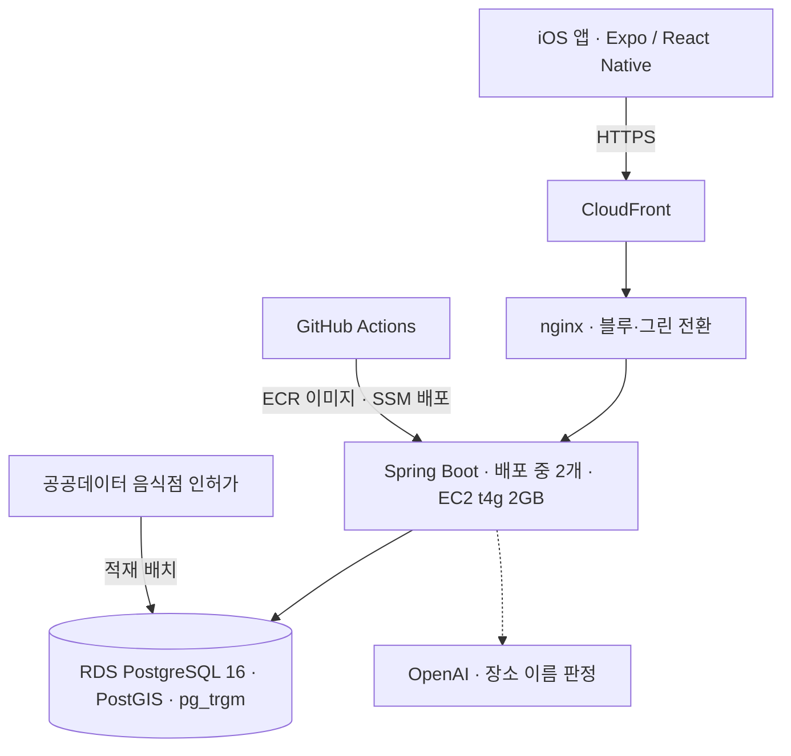
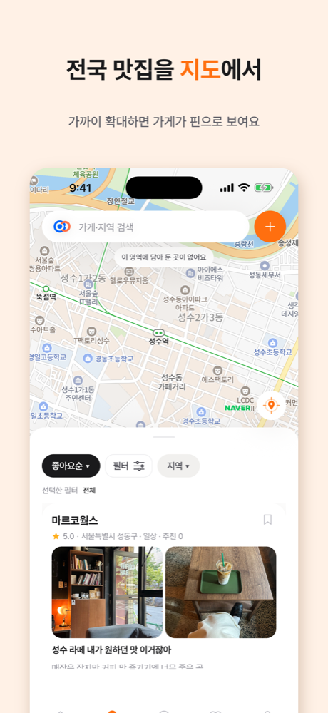

# 핀디쉬 PinDish

**목적에 맞는 맛집을 지도에서 찾고 공유하는 iOS 앱 — 1인 개발·운영 기록**

제품 소스는 비공개입니다. 이 레포는 설계 판단과 운영 중 풀어낸 문제를 정리합니다.

Spring Boot 백엔드, React Native 앱, AWS 인프라와 배포 파이프라인을 혼자 설계·개발하고 운영합니다. 중심은 백엔드입니다.

| 영역 | 한 일 |
|---|---|
| **API·데이터** | 지도 집계·근처 가게·피드·검색 API, 공공데이터 가게 53만 건 적재 배치 |
| **성능** | 53만 행에서 두 글자 검색 0.9초 → 0.1초, 추천 피드 전체 정렬 제거 |
| **정합성** | 비관 잠금 함정 수정, 공유된 장소 매칭률 62% → 77% |
| **앱** | Expo·React Native iOS 앱, 인스타 릴스·네이버 지도 공유로 가게 저장, 네이버 지도 SDK |
| **AI** | 주소로 후보를 좁힌 뒤 LLM이 판정하는 장소 매칭, 인플루언서 릴스 캡션으로 가게 한 줄 소개 생성 |
| **운영** | 블루·그린 배포, 스키마 호환성 CI, 업로드 OOM 해소·메모리 최고치 26% 감소, Sentry 알림 |

## 아키텍처

## 풀어낸 문제

### 1. 두 글자 검색만 0.9초

53만 행 가게 테이블에서 "김밥"·"치킨" 같은 두 글자 검색어만 쿼리가 0.9초 걸렸습니다("스타벅스"는 15ms).
두 글자 부분 일치는 기존 `pg_trgm` 인덱스로 범위를 좁히지 못했습니다.
bigram 표현식 GIN 인덱스를 추가하고, 검색어 길이에 따라 **SQL 자체를 나눴습니다.** 파라미터에 따라 갈리는 `OR` 조건으로 두면 범용 실행 계획이 인덱스를 쓰지 못하기 때문입니다. 결과는 0.07~0.13초입니다.
적재 뒤 통계가 갱신되지 않아 플래너가 53만 행을 훑던 문제도 찾아, 적재 배치 끝에 `ANALYZE`를 넣었습니다.

### 2. 글이 늘수록 느려지는 추천 피드

오늘의 추천은 요청마다 조건에 맞는 글 **전체**를 가게별로 줄 세우고, 날짜 해시로 다시 정렬한 뒤 20개를 잘랐습니다. 해시 정렬은 인덱스를 쓸 수 없어 지연이 글 수에 비례합니다.
옛 글 후보는 작성일 구간마다 정해진 개수만 읽고, 가게마다 보여 줄 수 있는 가장 최근 글만 고르도록 바꿨습니다. 조건을 담은 부분 인덱스 두 개를 `CONCURRENTLY`로 추가해, 실행 계획이 인덱스를 작성일 순으로 읽다가 `LIMIT`에서 멈춥니다.
"하루 동안 같고 날마다 바뀐다", "가게당 한 장" 같은 기존 동작은 통합 테스트로 고정한 채 바꿨습니다.

### 3. 잠갔는데도 끼어드는 INSERT

댓글을 지우는 동안 답글이 들어오면 답글이 함께 지워지면서 댓글 수가 어긋났습니다.
`PESSIMISTIC_WRITE`로 잠갔지만 Hibernate는 이를 `FOR NO KEY UPDATE`로 실행하고, 이 잠금은 외래 키 검사가 거는 `FOR KEY SHARE`와 충돌하지 않습니다.
네이티브 `FOR UPDATE`로 잠그고 삭제·집계는 다음 문장에서 하도록 바꿨습니다(READ COMMITTED는 문장마다 새 스냅샷을 봅니다). 답글 상한 같은 동시 요청 규칙은 각 요청을 별도 트랜잭션으로 실제 커밋하는 테스트로 검증합니다.

### 4. 배포 중에도 끊기지 않게

단일 EC2에서 새 컨테이너가 헬스 체크를 통과해야 nginx 업스트림을 전환하고, 실패하면 기존 컨테이너가 계속 서비스합니다.
배포 중에는 이전 버전 코드가 새 스키마를 읽습니다. 컬럼 삭제·이름 변경 같은 위험한 DDL과 이미 적용된 마이그레이션 수정은 CI 스크립트가 막고, 스키마 변경은 이전 코드와 호환되도록 여러 배포로 나눕니다.
`CREATE INDEX CONCURRENTLY`는 Flyway의 트랜잭션 잠금 커넥션을 끝없이 기다려 기동이 멈췄습니다. Flyway를 세션 잠금으로 바꿔 해결했습니다.

### 5. 2GB 인스턴스에서 JVM 메모리

메모리 2GB 인스턴스에 컨테이너 두 개를 번갈아 띄우려면 JVM 하나가 실제로 얼마나 쓰는지 알아야 했습니다. 힙 512MB로 고해상도 사진을 동시에 올리는 부하 테스트에서 **요청 다수가 direct buffer OOM으로 실패**했고, 부하가 끝난 뒤에도 프로세스가 1.6GB를 쥐고 있었습니다.
- `MultipartFile.getBytes()`가 파일 크기만큼 힙 밖 버퍼를 잡고 Tomcat 스레드마다 캐시했습니다 → `jdk.nio.maxCachedBufferSize`로 큰 임시 버퍼는 쓰고 바로 해제 → **OOM 해소**
- 이미지 디코딩에서 glibc가 스레드별 메모리 arena를 늘렸습니다 → `MALLOC_ARENA_MAX=2` → **최고 메모리 1104MB → 812MB**
- 운영 컨테이너에서 Serial GC가 선택되는 것을 확인해 G1GC를 명시하고 힙 상한을 고정했습니다. GC 로그로 증설 시점을 판단합니다.

### 6. 공유한 장소를 가게 데이터에 정확히 연결하기

네이버 지도 목록을 공유하면 서비스 DB의 가게와 연결합니다. 좌표 반경과 이름 유사도 규칙만으로는 62%만 붙었습니다.
반경 안 후보를 **주소가 같은 가게로 먼저 좁힌 뒤** LLM에 이름 판정을 맡겨 77%까지 올렸습니다. 주소로 좁히지 않고 맡기면 판정의 약 10%가 엉뚱한 가게로 붙었기 때문에, 좁히는 단계를 먼저 두었습니다.
판정했는데도 기존 가게가 없으면 네이버 정보로 공용 가게를 만들어 저장하고, 판정 호출이 실패한 항목은 보류했다가 서버 기동 때 다시 판정합니다. 여러 서버가 같은 가게를 다른 순서로 만들며 교착하지 않도록, 쓰기 전에 advisory lock으로 줄을 세웁니다.

## 테스트

로컬과 CI는 테스트 JVM마다 전용 PostGIS 컨테이너를 띄워 실제 PostgreSQL에서 통합 테스트를 돌립니다. 잠금·공간 쿼리처럼 H2로는 확인할 수 없는 동작을 그대로 검증하고, 인덱스 사용 여부는 실행 계획으로 따로 확인합니다.

## 기술 스택

- **Backend** Java 21 · Spring Boot 4 · JPA / Hibernate 7 · Spring Security · JWT · Flyway
- **Database** PostgreSQL 16 · PostGIS · pg_trgm
- **Infra** AWS (EC2 Graviton · RDS · CloudFront · ECR · SSM) · Docker · nginx
- **CI/CD** GitHub Actions
- **Ops** Sentry → Slack 알림 · PostHog
- **App** React Native · Expo · TypeScript · TanStack Query · Zustand · 네이버 지도 SDK

  

