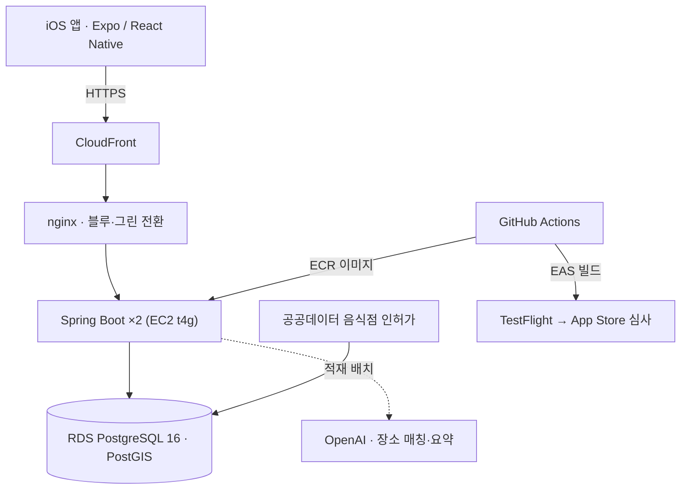

# 핀디쉬 PinDish

**데이트·회식·소개팅처럼 목적에 맞는 맛집을 지도에서 찾고 공유하는 iOS 앱**

제품 소스는 비공개입니다. 이 레포는 설계와 운영 경험을 소개합니다.

Java·Spring 백엔드, React Native 앱, AWS 인프라를 혼자 개발해 App Store에 출시하고 운영하고 있습니다.
2026년 7월 개발을 시작해 3개월 동안 PR 129개를 머지했고, 현재 v1.0.12입니다.

- **검색** — 한국어 두 글자 검색 쿼리 0.9초 → 0.1초
- **데이터** — 공공데이터 가게 53만 건 적재, 공유된 장소 목록 자동 매칭률 62% → 77% (확인된 오매칭 0건)
- **배포** — 단일 EC2 블루·그린 배포, 비호환 스키마 변경은 CI에서 차단
- **자동화** — 머지하면 TestFlight 업로드, 버전을 올리면 App Store 심사까지 자동 제출

  

## 풀어낸 문제

### 두 글자 검색만 느렸다

"김밥"·"치킨"처럼 두 글자 검색어에서만 쿼리가 0.9초 걸렸습니다(세 글자 이상은 15ms).
두 글자 부분 일치 검색은 기존 `pg_trgm` 인덱스로 범위를 좁히지 못했습니다.
bigram 표현식 GIN 인덱스를 추가하고 검색어 길이에 따라 SQL을 나눠, 인덱스를 타는 실행 계획을 확인했습니다(0.07~0.13초).
적재 후 통계가 갱신되지 않아 플래너가 53만 행을 훑던 문제도 함께 찾아, 적재 끝에 `ANALYZE`를 넣었습니다.

### 공유한 장소를 우리 가게 데이터에 정확히 연결하기

네이버 지도 목록을 공유하면 서비스 DB의 가게와 연결합니다. 좌표 반경과 이름 유사도 규칙만으로는 171곳 중 106곳에 그쳤습니다.
반경 안 후보를 **주소가 같은 가게로 먼저 좁힌 뒤** LLM에 이름 판정을 맡겨 131곳까지 올렸고, 결과를 하나씩 확인해 오매칭이 없음을 봤습니다.
좁히지 않고 맡기면 41곳 중 4곳이 틀렸습니다. 끝내 못 붙은 곳은 자동으로 만들지 않고 사용자가 확인하는 목록에 남깁니다.

### 배포하는 동안에도 끊기지 않게

단일 EC2 안에서 nginx가 두 컨테이너를 번갈아 받는 블루·그린 배포를 만들었습니다. 첫 전환 동안 헬스 체크 154건이 모두 200이었습니다.
배포 중에는 이전 버전 코드가 새 스키마를 읽습니다. 그래서 컬럼 삭제·이름 변경 같은 비호환 마이그레이션은 CI가 막고, 두 번의 배포로 나눠 적용합니다.

### 잠갔는데도 답글이 끼어들었다

댓글을 지우는 동안 답글이 들어오면, 답글이 함께 지워지면서 댓글 수가 어긋났습니다.
`PESSIMISTIC_WRITE`로 잠갔지만 Hibernate가 이를 `FOR NO KEY UPDATE`로 실행했고, 이 잠금은 외래 키 검사의 `FOR KEY SHARE`와 충돌하지 않았습니다.
네이티브 `FOR UPDATE`로 바꾸고, 각 요청을 별도 트랜잭션으로 실제 커밋하는 동시성 테스트로 검증했습니다.

## 아키텍처

## 일하는 방식

기능마다 워크트리를 나눠 Claude Code·Codex를 병렬로 운용하고, CI와 자동 코드리뷰 통과를 머지 조건으로 둡니다.
에이전트가 만든 변경은 직접 검증합니다. 검색은 실행 계획으로, 잠금은 동시성 테스트로 확인했습니다.

## 기술 스택

- **Backend** Java 21 · Spring Boot 4 · JPA · PostgreSQL 16 / PostGIS · Flyway
- **App** React Native · Expo · TypeScript · TanStack Query · Zustand · 네이버 지도 SDK
- **Infra** AWS (EC2 · RDS · CloudFront · ECR) · Docker · nginx · GitHub Actions · EAS
- **Ops** Sentry 오류 추적 · PostHog 사용 분석 · App Store Connect API
